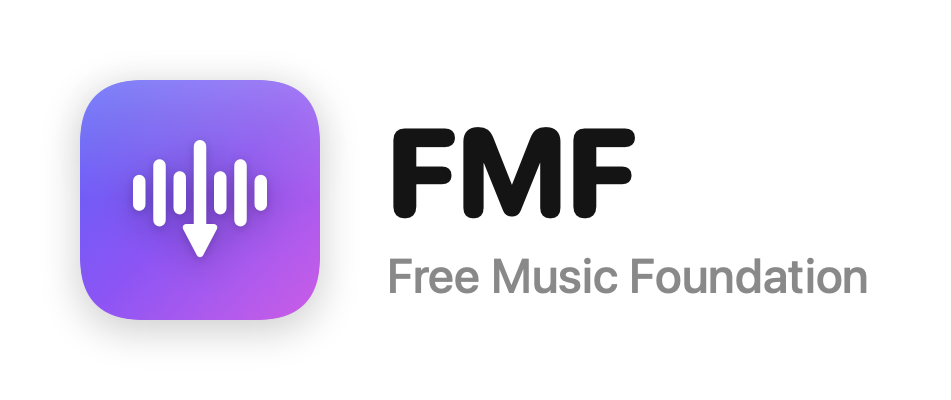
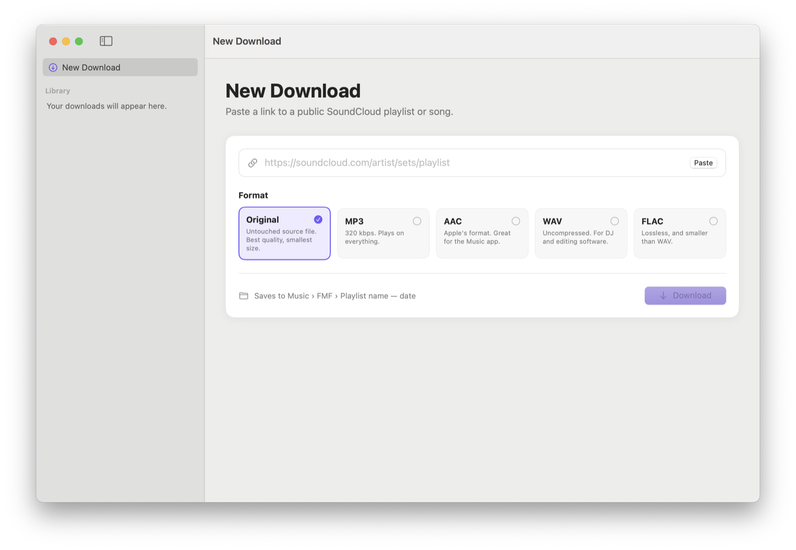

<p align="center">
  
</p>

<p align="center">
  A native Mac app that saves public SoundCloud playlists to your Mac, with cover art and full song details, in the format you want.
</p>

<p align="center">
  
</p>

## Features

- **Paste a link, get the playlist.** Works with public SoundCloud playlists and single songs.
- **Five formats.** Original (the untouched source stream, best quality), MP3 320 kbps, AAC, WAV, and FLAC.
- **Cover art inside every file.** Full-resolution artwork is embedded directly in each song, in every format, including WAV (as an ID3 tag, the standard that most DJ and music-tagging apps read).
- **Rich song details.** Artist, genre, upload date, plays, likes, reposts, license, and description from SoundCloud. When a song is also in Apple's music catalog, Resonance Studio adds the official album name, release date, track number, and a high-resolution album cover.
- **A real library.** Browse every playlist you've saved, see song details in an info panel, and play songs right inside the app.
- **A simple folder system.** Everything lives in a `Resonance Studio` folder on your Desktop, created automatically, with one folder per download, named with the playlist and the date:

  ```
  Desktop/
  └── Resonance Studio/
      └── Late Night Drive — 2026-11-18/
          ├── 01 - First Song.mp3
          └── 02 - Second Song.mp3
  ```

  Click **Show in Finder** on any playlist or song to jump straight to it.
- **No 30-second clips.** Songs that SoundCloud only offers as a Go+ preview are skipped and listed, instead of being saved as a clip.

## Requirements

- macOS 14 Sonoma or later, on Apple silicon
- An internet connection the first time you open the app

That's it. On first launch, Resonance Studio sets itself up by downloading the two free audio tools it uses, [yt-dlp](https://github.com/yt-dlp/yt-dlp) and [FFmpeg](https://ffmpeg.org) (about 95 MB, one time). Each download is checked against its published SHA-256 checksum before it's installed. yt-dlp keeps itself up to date automatically, so SoundCloud downloads keep working. Nothing needs to be typed into Terminal.

If you already have yt-dlp and FFmpeg installed with Homebrew, the app uses those instead.

## Build

Resonance Studio builds with the Xcode Command Line Tools. Xcode itself is not required.

```sh
git clone https://github.com/Oputzer/resonance-studio.git
cd resonance-studio
scripts/build-app.sh
open "build/Resonance Studio.app"
```

To install it, drag `build/Resonance Studio.app` into your Applications folder. The app is not notarized, so the first time you open it, right-click it and choose **Open**.

## Accounts and backend

Resonance Studio asks people to accept the [Terms of Use](legal/TERMS.md) and sign in with their email (a one-time code, no password) before using it. Sign-in uses [Supabase](https://supabase.com). Only the email address and Terms acceptance are stored. Download links never leave the Mac.

1. Create a Supabase project and run [`supabase/schema.sql`](supabase/schema.sql) in its SQL editor.
2. In **Authentication › Email Templates › Magic Link**, include `{{ .Token }}` so the email contains a 6-digit code.
3. Copy `Config/backend.env.example` to `Config/backend.env` and fill in your project URL and publishable key.
4. Run `scripts/build-app.sh` again.

Without a backend, Resonance Studio runs as a local test build and stores the email only on the Mac.

## Project layout

```
Sources/ResonanceStudio/
├── App/        App entry point
├── Models/     Formats, songs, playlists
├── Services/   Downloading, library, catalog lookup, accounts, playback
└── Views/      SwiftUI interface
legal/          Terms of Use and Privacy Policy
scripts/        Build scripts
supabase/       Database schema
web/            The original single-page web version
```

## Legal

Resonance Studio is a tool. You are responsible for what you download with it. Only download content you own, that the rights holder has made available for download, or that you otherwise have the right to copy. Using Resonance Studio means you accept the [Terms of Use](legal/TERMS.md), including the assumption of all risk.

Resonance Studio is an independent project and is not affiliated with, endorsed by, or sponsored by SoundCloud, Apple, or Spotify.

Code released under the [MIT License](LICENSE).
